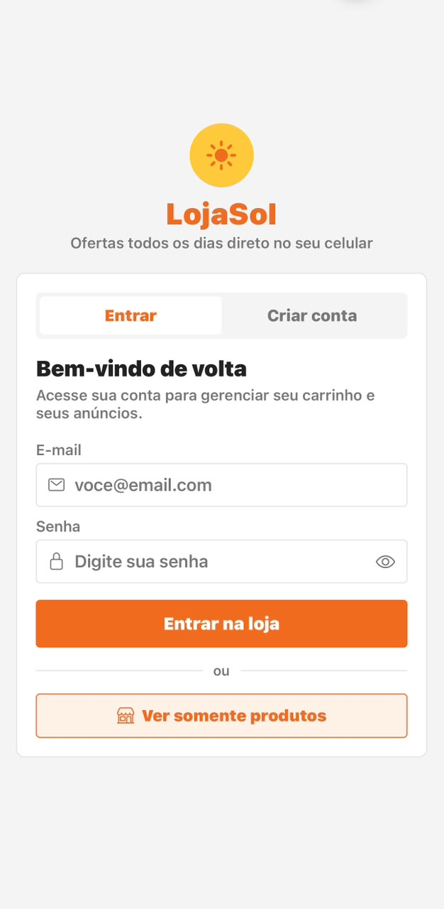

# LojaSol — Aplicativo Mobile de E-commerce

Aplicativo mobile de comércio eletrônico desenvolvido em **React Native** com **Expo**, estruturado em arquitetura modular, consumo assíncrono de API REST, carregamento paginado sob demanda (*Lazy Loading*), compressão local de imagens e persistência de dados offline com **SQLite**.

---

## Funcionalidades

- **Vitrine e Catálogo Dinâmico:** Listagem de produtos com busca em português, filtro por categorias (`Celulares`, `Notebooks`, `Perfumes`, `Móveis` e `Óculos`), ordenação (`Mais vendidos`, `Menor preço`, `Maior preço` e `Avaliação`) e paginação automática ao rolar a tela.
- **Detalhes, Favoritos e Carrinho:** Visualização completa do produto, cálculo de desconto e parcelamento, controle de quantidades, aplicação de cupons promocionais (`SOL10` e `FRETEGRATIS`) e simulação de checkout.
- **Autenticação e Modo Visitante:** Cadastro e login persistidos localmente no SQLite, além da opção **"Ver somente produtos"** para navegação livre sem conta (restringindo ações privadas como favoritar, anunciar e comprar).
- **Perfil do Usuário:** Edição de nome, telefone, CEP e endereço padrão com preenchimento automático na etapa de finalização de compra.
- **Publicação e Gestão de Anúncios:** Cadastro de novos produtos com seleção de foto na galeria, redimensionamento e compressão automática em JPEG e aba **Meus anúncios** com opção de marcar como vendido e remover.
- **Responsividade de Rotação de Tela:** Adaptação automática da grade de produtos entre **2 colunas** (modo retrato) e **3 colunas** (modo paisagem).

---

## Capturas de Tela

<p align="center">
  
  
  
  
  
</p>

---

## Tecnologias Utilizadas

- **React Native** & **Expo**
- **Expo SQLite (`expo-sqlite`)** — Banco de dados relacional local (`lojasol.db`) com fallback para `localStorage` no navegador
- **Expo Image Picker (`expo-image-picker`)** — Seleção de imagens da galeria do dispositivo
- **Expo Image Manipulator (`expo-image-manipulator`)** — Redimensionamento e compressão de fotos antes do armazenamento
- **Ionicons (`@expo/vector-icons`)** — Biblioteca de ícones da interface
- **DummyJSON API** — Fonte externa de produtos com camada de tradução e adaptação para português

---

## Estrutura do Projeto

```text
loja-mobile/
├── App.js                              # Navegação principal, estados globais, modais e responsividade
├── package.json                        # Dependências e scripts do projeto
├── prints/                             # Capturas de tela exibidas na documentação
└── src/
    ├── banco/
    │   └── bancoDados.js               # Inicialização e CRUD no SQLite (usuários, sessão, carrinho, favoritos e anúncios)
    ├── componentes/
    │   └── ElementosLoja.js            # Componentes reutilizáveis (CartaoProduto, SeletorQuantidade, LinhaResumo, EstadoVazio)
    ├── hooks/
    │   └── useCatalogo.js              # Hook customizado para busca assíncrona e paginação (Lazy Loading)
    ├── servicos/
    │   └── apiProdutos.js              # Consumo da API DummyJSON, timeout com AbortController e tradução PT-BR
    ├── telas/
    │   ├── TelaAnunciar.js             # Formulário de novo anúncio com compressão e listagem de itens publicados
    │   ├── TelaLogin.js                # Autenticação (Entrar / Criar conta) e acesso visitante
    │   └── TelaPerfil.js               # Resumo da conta, edição de endereço padrão e encerramento de sessão
    ├── tema/
    │   └── tokens.js                   # Paleta de cores e utilitários de formatação monetária
    └── utilitarios/
        └── compressorImagem.js         # Redimensionamento e compressão de fotos antes do salvamento
```

---

## Como Baixar e Executar o Projeto

### Pré-requisitos

- [Node.js](https://nodejs.org/) (versão LTS recomendada)
- [Git](https://git-scm.com/)
- Aplicativo **Expo Go** instalado no celular ([Android](https://play.google.com/store/apps/details?id=host.exp.exponent) ou [iOS](https://apps.apple.com/app/expo-go/id982107779))

### Passo a passo

1. **Clone este repositório:**
   ```bash
   git clone [https://github.com/Milaxx07/loja-mobile.git](https://github.com/Milaxx07/loja-mobile.git)
   ```

2. **Acesse a pasta do projeto:**
   ```bash
   cd loja-mobile
   ```

3. **Instale as dependências:**
   ```bash
   npm install
   ```

4. **Inicie o servidor de desenvolvimento do Expo:**
   ```bash
   npx expo start
   ```

5. **Execute o aplicativo:**
   - **No celular (Android/iOS):** Abra o aplicativo **Expo Go** e escaneie o QR Code exibido no terminal.
   - **No navegador (Web / DevTools):** Com o terminal em execução, pressione a tecla **`w`** para abrir a aplicação no Google Chrome.

---

## Autora

Desenvolvido por **Camila Gonçalves Bomfim**  
GitHub: [@Milaxx07](https://github.com/Milaxx07)